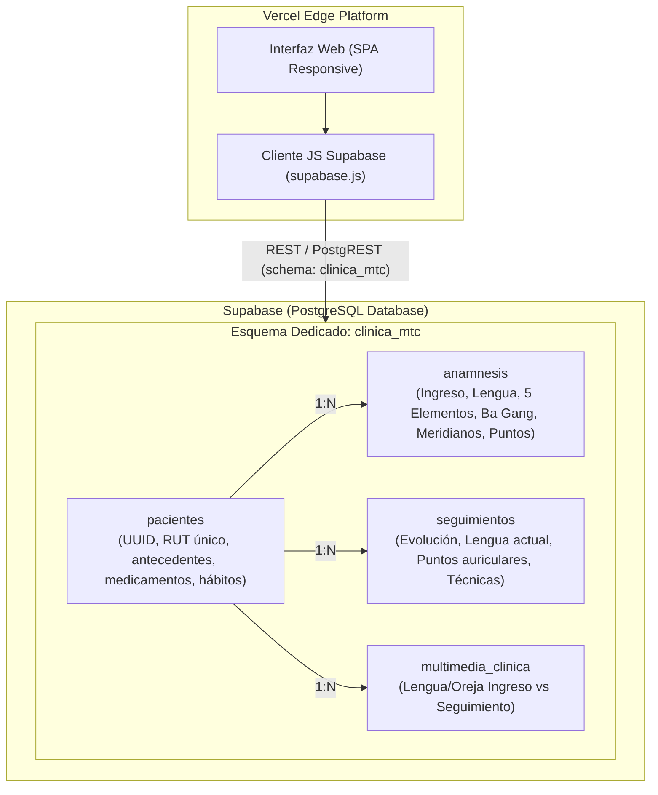

# 🌿 Sistema Clínico Cloud: Medicina Tradicional China & Auriculoterapia

> **Arquitectura Cloud:** Single Page Application (SPA) para la gestión clínica integral de acupuntura, diferenciación de síndromes (5 Elementos, Ba Gang, Zang-Fu) y auriculoterapia. Diseñada para ser alojada en repositorios Git, desplegada automáticamente en **Vercel** y conectada a **Supabase (PostgreSQL)** mediante un **esquema dedicado (`clinica_mtc`)**.

---

## 🏛️ 1. Arquitectura del Sistema



### ¿Por qué un Esquema Dedicado (`clinica_mtc`)?
En proyectos de nivel gratuito (*free tier*) de Supabase, el esquema por defecto `public` suele verse saturado o entrar en conflicto con otras tablas y extensiones de pruebas. Al aislar la clínica en el esquema `clinica_mtc`:
1. **Aislamiento Total:** Las tablas, tipos y políticas de seguridad (RLS) no interfieren con otros desarrollos en el mismo proyecto Supabase.
2. **Seguridad y Cumplimiento:** Permite restringir el acceso y aplicar políticas de retención clínica independientes.
3. **Optimización de Recursos:** Índices y búsquedas (`idx_pacientes_rut`, `idx_pacientes_nombre`) optimizadas para fichas médicas sin sobrecargar el catálogo global.

---

## 🎨 2. Identidad Visual y Experiencia de Usuario
- **Paleta de Colores Corporativa:** Tonos azul marino oscuro (`#0f274a`, `blue-900`) en barra superior, barra lateral y titulares; acentos en azul eléctrico (`#2563eb`, `blue-600`) para llamadas a la acción, contrastados con fondos limpios de nivel clínico (`#f8fafc`, `slate-50`) y tipografía contemporánea `Plus Jakarta Sans`.
- **Diseño Adaptativo:** 100% responsivo en escritorio, tablets y teléfonos móviles de consulta.
- **Microinteracciones y Feedback:** Modales accesibles, alertas toast flotantes temporizadas y badges con la colorimetría tradicional de los 5 Elementos.

---

## 📋 3. Módulos y Vistas Interactivas

| Módulo | Vista | Funcionalidades Principales |
|---|---|---|
| **Vista 1** | **Búsqueda & Selector de Pacientes** | Buscador instantáneo reactivo por Nombre o RUT, visualización cronológica tipo *timeline* de todas las sesiones pasadas, antecedentes, diagnósticos y botón para registrar nuevas visitas. |
| **Vista 2** | **Ficha de Ingreso (Anamnesis)** | Formulario clínico integral adaptado a las guías de MTC: filiación (con formateo de RUT chileno), motivo de consulta, antecedentes médicos y farmacológicos, hábitos biológicos, examen de lengua (cuerpo, color, saburra), 5 Elementos, 8 Principios Ba Gang, canales/órganos Zang-Fu y prescripción inicial de puntos auriculares con selección de materiales. |
| **Vista 3** | **Seguimiento de Sesión** | Formulario rápido para sesiones consecutivas (Sesión 2, 3, etc.), correlativo automático, evaluación comparativa del estado lingual, registro de evolución según escala de dolor, rotación de puntos y técnicas especiales (ventosas, moxa). |
| **Vista 4** | **Autocompletado Inteligente IA** | Zona *drag & drop* para arrastrar documentos o informes PDF previos. Extrae y homologa de forma automatizada los campos clínicos a la estructura de MTC y transfiere los datos a la Ficha de Ingreso en un clic. |
| **Vista 5** | **Evolución Fotográfica** | Módulo de glosodiagnosis y aurículodiagnóstico visual. Permite comparar la fotografía de la primera sesión frente al seguimiento actual tanto en modo **Lado a Lado (Paralelo)** como en modo **Split Slider (Deslizador interactivo Antes / Después)**. |

---

## 🗄️ 4. Configuración de Base de Datos en Supabase (Paso a Paso)

### Paso 1: Crear el Proyecto en Supabase
1. Ingresa a [supabase.com](https://supabase.com) e inicia sesión.
2. Haz clic en **"New Project"**, asigna un nombre (ej. `Clinica-MTC`) y define una contraseña segura para la base de datos.
3. Selecciona la región geográfica más cercana (ej. *South America - São Paulo*).

### Paso 2: Ejecutar el Script SQL de Creación
1. En el panel izquierdo de Supabase, entra a **"SQL Editor"**.
2. Haz clic en **"New Query"**.
3. Copia el contenido completo del archivo [`supabase_schema.sql`](./supabase_schema.sql) de este repositorio y pégalo en el editor.
4. Haz clic en **"Run"** (o presiona `Ctrl + Enter`).
5. El script creará:
   - El esquema `clinica_mtc`.
   - Las 4 tablas (`pacientes`, `anamnesis`, `seguimientos`, `multimedia_clinica`).
   - Los índices de búsqueda optimizada para RUT y texto.
   - Las funciones de actualización de timestamps y políticas RLS.
   - 2 pacientes de demostración clínica precargados (*María Elena Valenzuela* y *Carlos Alberto Soto*).

### Paso 3: Exponer el Esquema Dedicado en la API (Crucial)
Por defecto, Supabase solo expone el esquema `public`. Para que tu aplicación web pueda consultar `clinica_mtc` mediante PostgREST:
1. En el menú lateral de Supabase, ve a **Project Settings** (icono de engranaje) ➔ **API**.
2. Busca la sección **"Data API Settings"** (o **"Extra search path" / "Exposed schemas"**).
3. En el campo **"Exposed schemas"**, añade `clinica_mtc` separado por coma:
   ```text
   public, clinica_mtc
   ```
4. Guarda los cambios.

### Paso 4: Obtener las Credenciales de Conexión
En la misma página de **Settings ➔ API**, copia:
- **Project URL** (ej. `https://xyzabcdefghijklm.supabase.co`)
- **anon / public key** (llave JWT que empieza con `eyJ...`)

---

## 🚀 5. Despliegue en Vercel y Flujo Git

### Opción A: Despliegue mediante Vercel CLI (Línea de Comandos)
```bash
# 1. Instalar Vercel CLI si no lo tienes
npm install -g vercel

# 2. Iniciar sesión en Vercel
vercel login

# 3. Desplegar en producción
vercel --prod
```

### Opción B: Despliegue mediante Repositorio Git (GitHub / GitLab / Bitbucket)
1. **Inicializar y subir a tu repositorio Git:**
   ```bash
   git init
   git add .
   git commit -m "feat: implementacion sistema clinico MTC con Supabase y Vercel"
   git branch -M main
   git remote add origin https://github.com/TU_USUARIO/clinica-mtc.git
   git push -u origin main
   ```
2. **Importar en Vercel:**
   - Entra a tu dashboard de [vercel.com](https://vercel.com) y pulsa **"Add New... ➔ Project"**.
   - Selecciona tu repositorio recién creado.
   - En **Environment Variables**, añade:
     - `SUPABASE_URL`: `https://tu-proyecto.supabase.co`
     - `SUPABASE_ANON_KEY`: `eyJhbGciOi...`
     - `SUPABASE_SCHEMA`: `clinica_mtc`
   - Pulsa **"Deploy"**. Vercel configurará el dominio HTTPS global en segundos.

---

## 💻 6. Modo Local / Contingencia Offline Inmediata
La aplicación cuenta con un **sistema de resiliencia automática**:
- Si abres la aplicación sin haber configurado aún las variables de Supabase, la aplicación funcionará al 100% en modo **Local Demo**, almacenando pacientes, fichas y seguimientos en `localStorage` con la misma estructura y validaciones.
- En cualquier momento puedes hacer clic en el indicador superior **"Esquema: clinica_mtc ⚙️"** e ingresar directamente tu `SUPABASE_URL` y `SUPABASE_ANON_KEY` para sincronizar con la nube sin necesidad de volver a compilar.

---

## 📂 7. Estructura de Archivos del Proyecto

```text
├── index.html              # Vistas clínicas completas (SPA semántica con Tailwind CSS)
├── supabase.js             # Capa de cliente Supabase con soporte para esquema 'clinica_mtc'
├── app.js                  # Lógica reactiva de las 5 vistas y manipulación de datos
├── styles.css              # Estilos corporativos, slider fotográfico y microanimaciones
├── supabase_schema.sql     # Script DDL completo de PostgreSQL para Supabase
├── vercel.json             # Enrutamiento, headers de seguridad y reglas de Vercel
├── package.json            # Metadatos del proyecto y dependencias
├── .env.example            # Plantilla de variables de entorno cloud
├── .gitignore              # Exclusión de archivos sensibles y node_modules
└── README.md               # Manual de arquitectura, despliegue y uso clínico
```

---

## 🩺 8. Guía de Uso Clínico en Consulta
1. **Recepción del Paciente:**
   - Abre la pestaña **"Buscar Paciente"** y escribe el apellido o RUT. Si ya tiene ficha, revisa la evolución cronológica y los puntos que se le aplicaron en la sesión anterior.
2. **Nuevo Paciente:**
   - Ve a **"Nueva Anamnesis"** o arrastra su resumen médico en **"Autocompletado IA"** para ahorrar tiempo.
   - Selecciona el diagnóstico de lengua (Cuerpo, Color, Saburra) y marca los 5 Elementos correspondientes.
   - En el recuadro de Auriculoterapia, selecciona los puntos (ej. *Shen Men*, *Punto Cero*, *Hígado*) y el material (*Semillas de Vaccaria*, *Chinchetas*, *Balines dorados/magnéticos*). Guarda la ficha.
3. **Sesión Posterior:**
   - Ve a **"Seguimiento de Sesión"**, anota la respuesta del paciente, cambios en lengua y los nuevos puntos aplicados.
4. **Evaluación de Progreso:**
   - En **"Evolución Fotográfica"**, visualiza junto al paciente el cambio objetivo en el color y saburra de su lengua o pabellón auricular mediante el comparador deslizante.
